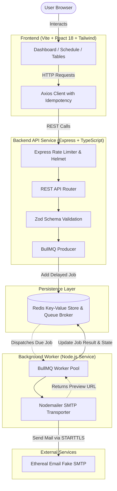

# ReachInbox — Full-Stack Email Job Scheduler

[](https://nodejs.org/)
[](https://www.typescriptlang.org/)
[](https://react.dev/)
[](https://bullmq.io/)
[](https://redis.io/)
[](https://www.mongodb.com/atlas)
[](https://developers.google.com/identity)
[](https://tailwindcss.com/)

A production-grade, distributed email scheduling platform built for high reliability, idempotent task processing, and clear observability. Features a modern landing page, Google OAuth authentication, persistent job history in MongoDB Atlas, precision delayed queues with BullMQ + Redis, and real-time monitoring.


---

## Table of Contents

- [System Architecture](#system-architecture)
- [Core Features](#core-features)
- [Tech Stack](#tech-stack)
- [Directory Structure](#directory-structure)
- [Prerequisites](#prerequisites)
- [Quick Start](#quick-start)
  - [1. Running with Docker Compose (Recommended)](#1-running-with-docker-compose-recommended)
  - [2. Running Locally (Bare Metal)](#2-running-locally-bare-metal)
- [Environment Variables](#environment-variables)
- [API Reference](#api-reference)
- [Worker & Reliability Architecture](#worker--reliability-architecture)
- [Testing](#testing)
- [Production Deployment](#production-deployment)

---

## System Architecture



---

## Core Features

1. **Precision Delayed Execution**: Computes exact delays in milliseconds from client timezones normalized to UTC ISO-8601 timestamps. BullMQ's Redis-backed sorted sets trigger execution without CPU-intensive polling loops.
2. **Strict Idempotency**: Accepts custom `X-Idempotency-Key` or deterministic client-generated job IDs to prevent duplicate email scheduling upon network blips or rapid double-submissions.
3. **Decoupled Worker Architecture**: The HTTP API and the Queue Worker run in separate processes. If the worker crashes or restarts, the API continues accepting requests, and pending jobs in Redis resume automatically upon worker reconnect.
4. **Resilient Retry & Backoff**: Exponential backoff policies (3 attempts with configurable delay) for transient SMTP network drops, capturing failure reasons without dropping queue state.
5. **Real-time Observability Dashboard**: Live stat counters (Scheduled, Processing, Sent, Failed), cancellation controls for queued jobs, full job detail inspection, and direct Ethereal test message preview links.
6. **Graceful Shutdown**: Intercepts `SIGINT` and `SIGTERM` across both API and Worker processes to drain active jobs and close Redis connection pools cleanly.

---

## Tech Stack

### Frontend
- **Framework**: React 18 with TypeScript
- **Tooling**: Vite for fast bundling and HMR
- **Styling**: Tailwind CSS & Lucide React icons
- **Routing**: React Router DOM v6
- **HTTP**: Axios with centralized error formatting

### Backend
- **Runtime**: Node.js (>= 18) with TypeScript
- **Framework**: Express.js
- **Queue Engine**: BullMQ (v5)
- **Data Store**: Redis (with AOF persistence configured)
- **Email Protocol**: Nodemailer with Ethereal SMTP STARTTLS support
- **Validation**: Zod schema validation
- **Logging & Security**: Winston, Morgan, Helmet, CORS, and Express Rate Limit

---

## Directory Structure

```text
email-scheduler/
├── docker-compose.yml          # Multi-container orchestration (Redis, API, Worker, Client)
├── .gitignore
├── README.md
├── server/
│   ├── Dockerfile              # Multi-stage production container for API & Worker
│   ├── package.json
│   ├── tsconfig.json
│   ├── .env.example
│   ├── src/
│   │   ├── app.ts              # Express application setup
│   │   ├── server.ts           # API entry point & HTTP listener
│   │   ├── worker.ts           # Dedicated Worker entry point
│   │   ├── config/             # Typed config and Redis client connection
│   │   ├── controllers/        # Express route handlers
│   │   ├── middleware/         # Error handlers and rate limiters
│   │   ├── queues/             # BullMQ queue instantiation
│   │   ├── routes/             # REST route declarations
│   │   ├── services/           # Business logic (job scheduling, stats, SMTP)
│   │   ├── validators/         # Zod payload validators
│   │   └── workers/            # BullMQ worker processors
│   └── tests/                  # Jest & Supertest automated test suite
└── client/
    ├── Dockerfile              # Multi-stage container (Vite build + Nginx static server)
    ├── nginx.conf              # SPA route fallback & asset caching
    ├── package.json
    ├── vite.config.ts
    ├── tailwind.config.js
    └── src/
        ├── components/         # Reusable UI components (StatCard, EmailTable, Modal, etc.)
        ├── pages/              # Dashboard, Schedule, Scheduled, Sent, Failed, Details
        ├── services/           # Axios API service
        └── utils/              # Timezone conversions and date formatting
```

---

## Prerequisites

- **Node.js**: v18.0.0 or higher
- **npm**: v9.0.0 or higher
- **Redis**: v6.0 or higher (or Docker)
- **Docker & Docker Compose** (optional, recommended for isolated setup)

---

## Quick Start

### 1. Running with Docker Compose (Recommended)

Docker Compose provisions Redis with AOF persistence, builds the TypeScript backend, runs separate containers for the API and the BullMQ worker, and serves the frontend through Nginx.

```bash
# Clone the repository and navigate into the project directory
cd email-scheduler

# Configure environment variables
cp server/.env.example server/.env
cp client/.env.example client/.env

# Spin up all services
docker compose up --build
```

Access the applications:
- **Frontend Dashboard**: [http://localhost:5173](http://localhost:5173) (or `http://localhost:80` in containerized Nginx)
- **Backend Health Check**: [http://localhost:3001/api/health](http://localhost:3001/api/health)
- **Redis Instance**: `localhost:6379`

To stop:
```bash
docker compose down
```

---

### 2. Running Locally (Bare Metal)

#### Step 1: Start Redis
Ensure Redis is running locally on port `6379`:
```bash
redis-server
```

#### Step 2: Configure & Start Server
```bash
cd server
cp .env.example .env

# Edit .env with your Ethereal credentials:
# (Generate a free one in 5 seconds at https://ethereal.email/create)
# SMTP_USER=your_user@ethereal.email
# SMTP_PASS=your_password

npm install

# Start the API server in dev mode
npm run dev
```

#### Step 3: Start the BullMQ Worker (Separate Terminal)
```bash
cd server
npm run dev:worker
```

#### Step 4: Configure & Start Client (Separate Terminal)
```bash
cd client
cp .env.example .env.local
npm install
npm run dev
```
Open [http://localhost:5173](http://localhost:5173) in your browser.

---

## Environment Variables

### Server (`server/.env`)

| Variable | Required | Default | Description |
| :--- | :--- | :--- | :--- |
| `PORT` | No | `3001` | Port for the Express REST API |
| `NODE_ENV` | No | `development` | Runtime environment (`development` / `production`) |
| `REDIS_URL` | No | `redis://localhost:6379` | Full connection string for Redis |
| `REDIS_HOST` | No | `localhost` | Redis host (if not using `REDIS_URL`) |
| `REDIS_PORT` | No | `6379` | Redis port |
| `SMTP_HOST` | Yes | `smtp.ethereal.email` | SMTP relay server |
| `SMTP_PORT` | Yes | `587` | SMTP port |
| `SMTP_USER` | Yes | — | Ethereal account username |
| `SMTP_PASS` | Yes | — | Ethereal account password |
| `SMTP_FROM` | No | `ReachInbox <noreply@ethereal.email>` | Default sender string |
| `FRONTEND_URL` | No | `http://localhost:5173` | Allowed CORS origin |
| `WORKER_CONCURRENCY`| No | `5` | Concurrent jobs processed by worker |
| `JOB_ATTEMPTS` | No | `3` | Maximum retry attempts for failed jobs |
| `JOB_BACKOFF_DELAY` | No | `5000` | Backoff delay between retries in milliseconds |

### Client (`client/.env.local`)

| Variable | Required | Default | Description |
| :--- | :--- | :--- | :--- |
| `VITE_API_URL` | Yes | `http://localhost:3001` | Base URL of the backend API |

---

## API Reference

### 1. Schedule an Email
- **Endpoint**: `POST /api/emails/schedule`
- **Headers**:
  - `Content-Type: application/json`
  - `X-Idempotency-Key: <unique-string>` *(optional, recommended)*
- **Body**:
  ```json
  {
    "to": "recipient@example.com",
    "subject": "Quarterly Performance Update",
    "body": "Hi team,\nHere is the updated summary for Q3.",
    "scheduledAt": "2026-11-01T09:00:00.000Z",
    "timezone": "America/New_York"
  }
  ```
- **Response** (`201 Created`):
  ```json
  {
    "success": true,
    "data": {
      "jobId": "email-b1a9f4c0-...",
      "scheduledAt": "2026-11-01T09:00:00.000Z",
      "delay": 586800000
    },
    "message": "Email scheduled successfully"
  }
  ```

### 2. Get Aggregated Dashboard Stats
- **Endpoint**: `GET /api/dashboard/stats`
- **Response** (`200 OK`):
  ```json
  {
    "success": true,
    "data": {
      "total": 12,
      "delayed": 4,
      "active": 1,
      "completed": 6,
      "failed": 1,
      "cancelled": 0
    }
  }
  ```

### 3. List Scheduled Emails
- **Endpoint**: `GET /api/emails/scheduled`
- **Response** (`200 OK`):
  ```json
  {
    "success": true,
    "data": {
      "count": 4,
      "jobs": [
        {
          "id": "email-b1a9f4c0-...",
          "status": "delayed",
          "data": {
            "to": "recipient@example.com",
            "subject": "Quarterly Performance Update",
            "scheduledAt": "2026-11-01T09:00:00.000Z",
            "timezone": "America/New_York"
          },
          "attemptsMade": 0,
          "delay": 586800000
        }
      ]
    }
  }
  ```

### 4. List Sent Emails
- **Endpoint**: `GET /api/emails/sent`
- **Response** (`200 OK`): Returns completed jobs with `result.previewUrl` linking directly to the Ethereal message view.

### 5. List Failed Emails
- **Endpoint**: `GET /api/emails/failed`
- **Response** (`200 OK`): Returns failed jobs with `failedReason` and attempt counts.

### 6. Get Email Job Details
- **Endpoint**: `GET /api/emails/:id`
- **Response** (`200 OK`): Full job metadata, timestamps, and return value.

### 7. Cancel a Scheduled Email
- **Endpoint**: `DELETE /api/emails/:id`
- **Response** (`200 OK`):
  ```json
  {
    "success": true,
    "data": {
      "cancelled": true,
      "reason": "Job cancelled successfully (was delayed)"
    }
  }
  ```

### 8. System Health
- **Endpoint**: `GET /api/health`
- **Response** (`200 OK`): Returns health status of the API and connection state to Redis.

---

## Worker & Reliability Architecture

- **Delayed Queue Semantics**: BullMQ stores delayed jobs in a Redis sorted set indexed by execution timestamp (`now + delay`). The worker listens to due timestamps without holding active connections in polling sleep loops.
- **Process Isolation**: The worker is configured with a rate limiter (`max: 10, duration: 1000`) to prevent overwhelming SMTP endpoints.
- **Dead-Letter & Failure Auditing**: When maximum attempts (`JOB_ATTEMPTS=3`) are exhausted, the job transitions into the `failed` set with stack trace details preserved for inspection in the dashboard.
- **Graceful Lifecycle**:
  ```ts
  const shutdown = async (signal: string) => {
    logger.info(`Received ${signal}. Shutting down worker gracefully...`);
    await worker.close();
    await redisConnection.quit();
    process.exit(0);
  };
  ```

---

## Testing

Comprehensive unit and integration test suites cover validation logic and REST controllers:

```bash
cd server
npm test
```

To run test coverage reports:
```bash
npm run test:coverage
```

Test suites use mocked Redis and BullMQ queues to ensure fast, deterministic CI execution without requiring an active external Redis service.

---

## Production Deployment

### Option A: Render / Fly.io / Railway
1. **Redis**: Spin up a managed Redis instance (e.g., Upstash or Render Redis). Copy the Redis connection string.
2. **API Service**:
   - Build Command: `npm install && npm run build`
   - Start Command: `npm start`
   - Env Vars: `REDIS_URL`, `SMTP_USER`, `SMTP_PASS`, `FRONTEND_URL`
3. **Background Worker Service**:
   - Build Command: `npm install && npm run build`
   - Start Command: `npm run start:worker`
   - Env Vars: `REDIS_URL`, `SMTP_USER`, `SMTP_PASS`
4. **Client (Static Site / Vercel / Netlify)**:
   - Build Command: `npm install && npm run build`
   - Publish Directory: `dist`
   - Env Vars: `VITE_API_URL=https://your-api.onrender.com`

### Option B: Single VM via Docker Compose
Deploy `docker-compose.yml` to any Ubuntu/Debian VPS:
```bash
git clone <repo-url>
cd email-scheduler
docker compose up -d --build
```
